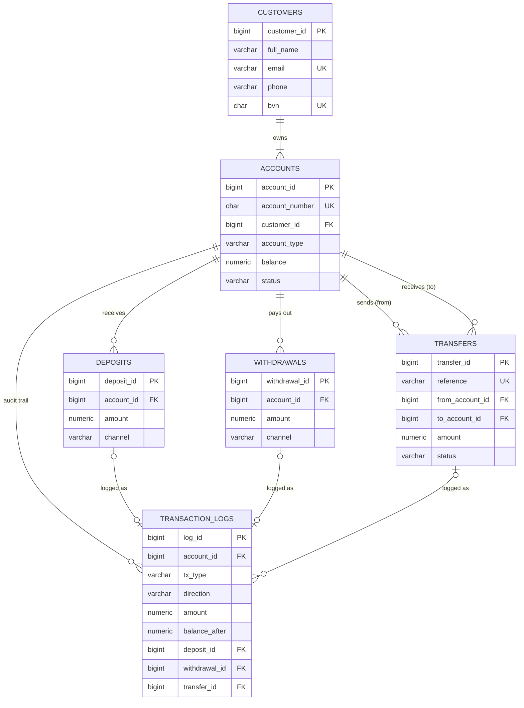

# Farpoint ER diagram

GitHub draws the diagram below automatically (it is written in Mermaid).

**How to read it:** one customer owns one or more accounts. Every deposit, withdrawal and transfer touches an account, and each balance change also leaves one row in `transaction_logs`. A transfer has two accounts (sender and receiver), which is why `accounts` links to `transfers` twice.
